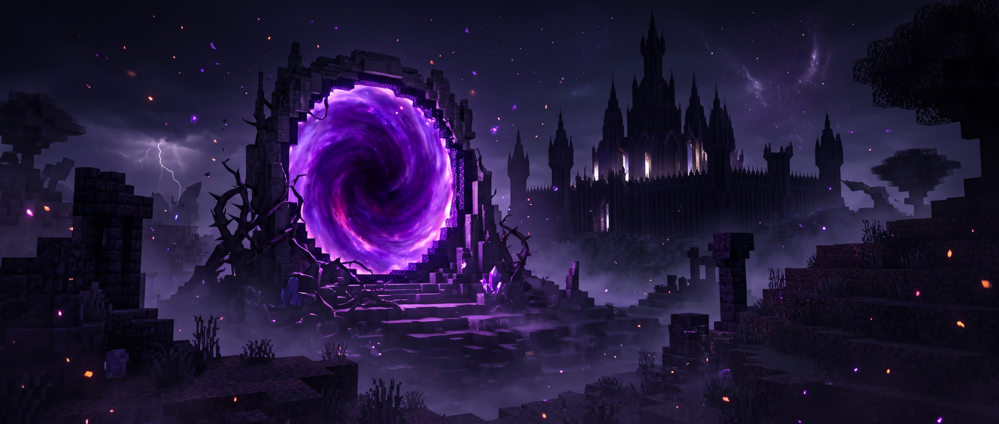

  

    

  <h1>🌑 Return to Chronicles of Darkness</h1>
  <h3><i>Official Development Team & Infrastructure</i></h3>

  

    
    
    
    
  

  

    <b>Погружение в суровый мир тёмного фэнтези.</b> 
    Собственное программное обеспечение, бескомпромиссная оптимизация и бесшовный вход на сервер.
  

---

### ⚔️ О проекте RtCoD

> **RtCoD** — масштабный хардкорный RPG-проект на базе **Minecraft Forge 1.20.1**. 
> Мы создаём цельную экосистему с уникальным игровым балансом, кастомными измерениями, глубокой системой рас и собственным клиентским лаунчером для комфортного подключения игроков.

---

### 🚀 Основной клиентский софт

<table align="center" width="100%">
  <tr>
    <td align="left" width="100%" style="padding: 16px;">
      <h3>🛠️ <a href="https://github.com/RtCoD-Stuff/rtcod-launcher">RtCoD Launcher</a></h3>
      

        Официальный кастомный лаунчер проекта для игроков и команды. Разработан для автоматической доставки обновлений модов, ресурсов и быстрой синхронизации с сервером.
      

      <ul>
        <li><b>Безопасная авторизация</b> и хранение пользовательских сессий</li>
        <li><b>Фоновая синхронизация</b> сборки модов и конфигураций</li>
        <li><b>Низкое потребление памяти</b> и оптимизированная загрузка ресурсов</li>
        <li><b>Интеграция с инфраструктурой</b> сервера под ключ</li>
      </ul>
      

        
        
        
      

    </td>
  </tr>
</table>

---

### 🛡️ Технологический стек инфраструктуры

   
  <i>C# • .NET Core • Java 17 • Minecraft Forge API • Python • Git • Linux Infrastructure</i>

---

### 👥 Команда разработки

| Роль | Участник | Зона ответственности |
| :--- | :--- | :--- |
| 👑 **Project Lead / Founder** | `@BlezeGotHub` | Идея, видение мира и менеджмент проекта |
| 💻 **Lead Developer** | `@Goblin-Inc` | Архитектура модов, лаунчер, бэкенд и серверная логика |
| 🎨 **3D Art & Modeling** | `Команда моделлеров` | 3D-модели боссов, уникальное вооружение и ассеты |
| 🛡️ **QA & Community** | `Тестеры и медиа` | Тестирование механик, балансировка и продвижение |

---

  © 2026 RtCoD Team. Все права на модификации и софт защищены.

